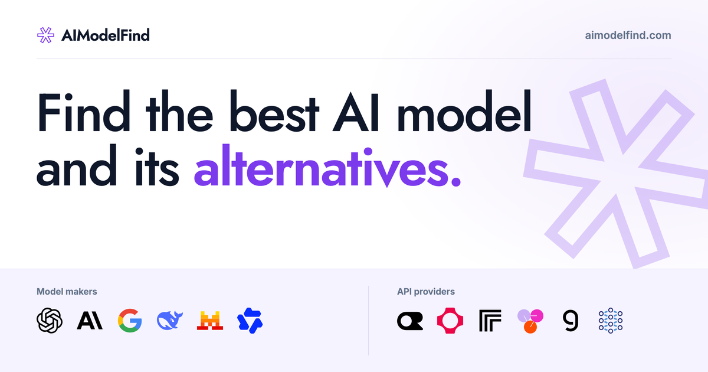

# Find AI Model

  

  

  <strong>为你的任务找到最适合的 AI 模型及其替代方案。</strong> 
  按质量、价格和提供商，对比文本、图像、视频与音频模型。

  
  

这是 [find-ai-model.com](https://find-ai-model.com/) 的介绍仓库。目录每日更新，目前覆盖 **1700+ 个模型**、**230+ 家提供商** 和 **190+ 家模型厂商**。

Find the best AI model and its alternatives. Compare text, image, video and audio models by quality, price and provider. The catalogue is updated daily.

## 链接

| | URL |
|---|---|
| **网站** | https://find-ai-model.com/ |
| **中文版** | https://find-ai-model.com/zh |
| **全部模型** | https://find-ai-model.com/models |
| **提供商** | https://find-ai-model.com/providers |
| **模型定价** | https://find-ai-model.com/pricing |
| **编程模型** | https://find-ai-model.com/models?task=coding |

## 能做什么

- **按任务选模型**：从编程、图像生成、视频生成、语音音频等任务出发，而不是只靠模型名。
- **对比价格与提供商**：同一模型可看各家官方标价，并高亮目录中的最低价。
- **覆盖多种模态**：文本 / 大语言模型、图像、视频、音频，以及开源权重、免费可用、长上下文等筛选。
- **看提供商与厂商**：浏览网关、推理主机、云和媒体平台，也可按实验室查看模型阵容。
- **热门对决**：如 Claude vs GPT、Gemini vs GPT、DeepSeek vs Qwen、Veo vs Sora、Kling vs Seedance 等。
- **中英双语**：英文首页在 `/`，中文在 `/zh`。

## 按任务开始

- [编程最佳 AI](https://find-ai-model.com/models?task=coding) — 按 LMArena WebDev 等榜单参考排名
- [最便宜的文本模型](https://find-ai-model.com/models?sort=price) — 按输出价从低到高
- [模型定价](https://find-ai-model.com/pricing) — 价格与提供商一览
- [全部模型](https://find-ai-model.com/models) — 可按文本、图像、视频、开源权重、免费可用等条件筛选
- [全部提供商](https://find-ai-model.com/providers)

## 数据说明

站内纪录基于官方标价与模型元数据每日重算。同一模型在不同提供商上的价格可能不同，页面会标明最低价来自哪一家。具体数字以 [find-ai-model.com](https://find-ai-model.com/) 实时目录为准。

## English

[Find AI Model](https://find-ai-model.com/) helps you find the best AI model for a task and compare its alternatives. Browse text, image, video and audio models by quality, price and provider.

The live catalogue is updated daily and currently covers 1,700+ models, 230+ providers and 190+ model makers. Prices come from official listings; the same model can cost different amounts across providers, and the site highlights the lowest listed price.

Start here: [Home](https://find-ai-model.com/) · [Chinese](https://find-ai-model.com/zh) · [All models](https://find-ai-model.com/models) · [Providers](https://find-ai-model.com/providers) · [Pricing](https://find-ai-model.com/pricing) · [Coding models](https://find-ai-model.com/models?task=coding)
